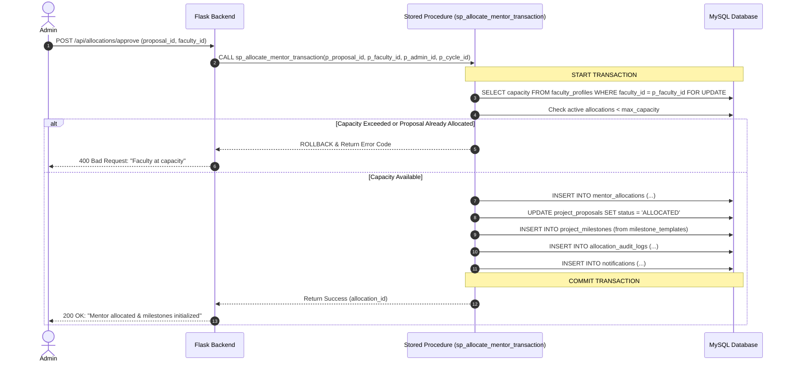

# LearnLink System Architecture

This document describes the high-level system architecture, component responsibilities, data flow, security model, and directory structure for the **LearnLink** platform.

---

## 1. High-Level Architecture Overview

LearnLink follows an industry-standard **3-Tier Decoupled Architecture**:
1. **Presentation Layer (Client)**: Modern Single-Page Application (SPA) built with React + Vite and Tailwind CSS.
2. **Application Layer (Server)**: Modular REST API service built with Python Flask, implementing an application factory pattern with blueprint separation and SQLAlchemy ORM.
3. **Data Layer (Storage & Engine)**: MySQL 8.0 relational database handling relational constraints, transactions, stored procedures, triggers, views, and indexes.

```
┌────────────────────────────────────────────────────────┐
│               PRESENTATION LAYER (CLIENT)              │
│       React + Vite + Tailwind CSS + Context API        │
│    Role-Based Dashboards (Student / Faculty / Admin)   │
└───────────────────────────┬────────────────────────────┘
                            │ HTTPS / REST API
                            │ (JSON Payloads + Bearer JWT)
┌───────────────────────────▼────────────────────────────┐
│              APPLICATION LAYER (FLASK API)             │
│  ├── Auth Blueprint (JWT Token Issuance, RBAC Guards)  │
│  ├── User / Profile Blueprints                         │
│  ├── Skills & Peer Exchange Blueprint                  │
│  ├── Projects & Teams Blueprint                        │
│  ├── Allocation Engine & Stored Procedure Invoker      │
│  ├── Milestones & Reviews Blueprint                    │
│  └── Analytics & Reporting Blueprint                   │
└───────────────────────────┬────────────────────────────┘
                            │ MySQL Connector / SQLAlchemy ORM
                            │ Raw SQL Execution for Stored Procs & Views
┌───────────────────────────▼────────────────────────────┐
│               DATA LAYER (MYSQL 8.0 RDBMS)             │
│  ├── 3NF Normalized Relational Tables                  │
│  ├── Integrity Constraints (PK, FK, CHECK, UNIQUE)    │
│  ├── ACID Stored Procedures (Locking Allocation)       │
│  ├── Database Triggers (Capacity Checks, Audit Logs)   │
│  ├── Materialized/Virtual Views (Workload, Skill-Gaps) │
│  └── Performance Indexes (Composite & Foreign Keys)    │
└────────────────────────────────────────────────────────┘
```

---

## 2. Component Breakdown

### 2.1 Client Layer (Frontend)
- **Framework**: React 18+ with Vite for fast HMR and optimized production builds.
- **Styling**: Tailwind CSS for responsive, modern UI components.
- **Routing**: `react-router-dom` with protected routes enforcing Role-Based Access Control (RBAC):
  - **Public Routes**: `/login`, `/register`, `/forgot-password`
  - **Student Portal**: `/student/profile`, `/student/skills`, `/student/projects`, `/student/proposals`, `/student/peer-learning`, `/student/milestones`
  - **Faculty Portal**: `/faculty/dashboard`, `/faculty/expertise`, `/faculty/proposals-review`, `/faculty/allocated-projects`, `/faculty/milestone-feedback`
  - **Admin Portal**: `/admin/cycles`, `/admin/departments`, `/admin/domains`, `/admin/allocation-engine`, `/admin/reports`, `/admin/audit-logs`
- **State Management**: React Context (`AuthContext`, `NotificationContext`) and custom hooks for API calls.

### 2.2 Application Layer (Backend)
- **Framework**: Flask (Python 3.10+).
- **Architecture Pattern**: Application Factory (`create_app`) with Blueprints.
- **Authentication**: JWT (`Flask-JWT-Extended` or PyJWT) with access and refresh tokens.
- **ORM & Data Access**:
  - **SQLAlchemy ORM** for general CRUD operations and schema migrations (`Flask-Migrate` / Alembic).
  - **Direct SQL Execution** (`db.session.execute`) for calling MySQL Stored Procedures, Views, and specialized matching queries.
- **Security**:
  - `Werkzeug` / `bcrypt` for one-way salted password hashing.
  - Role verification decorators: `@role_required('STUDENT')`, `@role_required('FACULTY')`, `@role_required('ADMIN')`.
  - CORS configuration with whitelist protection.

### 2.3 Data Layer (MySQL RDBMS)
- **Storage Engine**: `InnoDB` (guaranteeing row-level locking, foreign key constraints, and full ACID compliance).
- **Character Set**: `utf8mb4` with `utf8mb4_unicode_ci` collation.
- **Business Logic Enforcement**:
  - Business rules that can never be bypassed (such as faculty capacity limits, single active supervisor, unique team membership) are enforced at the database layer using Triggers and Unique Constraints.
  - Multi-table writes (such as approving proposals, assigning mentors, and generating milestones) run inside atomic MySQL Stored Procedures with row locking (`SELECT ... FOR UPDATE`).

---

## 3. Directory Structure

```
capstone_project/
├── docs/                               # Comprehensive project documentation
│   ├── README.md                       # Documentation hub index
│   ├── ARCHITECTURE.md                 # System architecture (this file)
│   ├── DATABASE_SCHEMA.md              # Full DB data dictionary & DDL
│   ├── PHASES_AND_CHECKLIST.md         # Phased checklist and progress tracker
│   └── PROJECT_LOGS.md                 # Date-wise development logs
├── project_plan.md                     # High-level initial proposal & concept
├── backend/                            # Flask API service
│   ├── app/
│   │   ├── __init__.py                 # Flask application factory
│   │   ├── config.py                   # Environment configs (Dev, Test, Prod)
│   │   ├── models/                     # SQLAlchemy models for all 30 tables
│   │   │   ├── __init__.py
│   │   │   ├── user.py
│   │   │   ├── skill.py
│   │   │   ├── project.py
│   │   │   ├── allocation.py
│   │   │   └── milestone.py
│   │   ├── auth/                       # Authentication blueprint
│   │   ├── users/                      # User profiles blueprint
│   │   ├── skills/                     # Skills catalog & management
│   │   ├── projects/                   # Ideas, teams, proposals
│   │   ├── allocation/                 # Recommendation engine & allocations
│   │   ├── milestones/                 # Milestones, submissions, reviews
│   │   ├── peer_learning/              # Peer guidance, sessions, reviews
│   │   ├── reports/                    # Views & analytical dashboards
│   │   └── utils/                      # Helper decorators, validation, errors
│   ├── sql/                            # Standalone SQL scripts (for DB setup)
│   │   ├── 01_schema_ddl.sql           # Complete table creation script
│   │   ├── 02_constraints.sql          # Foreign keys, check constraints, indexes
│   │   ├── 03_views.sql                # Analytical and reporting views
│   │   ├── 04_stored_procedures.sql    # Complex transaction procedures
│   │   ├── 05_triggers.sql             # Integrity & audit triggers
│   │   └── 06_seed_data.sql            # Master data & test scenario seeds
│   ├── migrations/                     # Alembic migration versions
│   ├── tests/                          # Automated backend tests
│   ├── requirements.txt                # Python dependencies
│   └── run.py                          # Server entry point
└── frontend/                           # React + Vite application
    ├── public/
    ├── src/
    │   ├── api/                        # Axios instances and API services
    │   ├── assets/                     # Logos, icons, graphics
    │   ├── components/                 # Reusable UI components (Navbar, Modal, etc.)
    │   ├── context/                    # Auth and global contexts
    │   ├── hooks/                      # Custom React hooks
    │   ├── layouts/                    # Role-specific dashboard layouts
    │   ├── pages/                      # Page components grouped by role
    │   │   ├── auth/
    │   │   ├── student/
    │   │   ├── faculty/
    │   │   └── admin/
    │   ├── utils/                      # Formatters, constants, helpers
    │   ├── App.jsx                     # Route definitions & guards
    │   └── main.jsx                    # Application entry point
    ├── package.json
    ├── tailwind.config.js
    └── vite.config.js
```

---

## 4. Key Workflows & Data Flows

### 4.1 Explainable Mentor Allocation Flow


### 4.2 Team Skill-Gap Analysis Flow
```mermaid
flowchart TD
    A[Student Team Created] --> B[Link to Project Idea / Domain]
    B --> C[Fetch Required Skills for Idea from DB]
    C --> D[Fetch All Skills Offered by Team Members from user_skills]
    D --> E[Compute Missing Skills via vw_team_skill_gaps]
    E --> F{Any Missing Skills?}
    F -- Yes --> G[Generate Warning in Team Dashboard]
    G --> H[Suggest Peer Mentors Offering the Missing Skill]
    F -- No --> I[Mark Team Skill Coverage as Complete (100%)]
```

---

## 5. Security & Data Integrity Principles

1. **Defense in Depth**:
   - Validation occurs at the UI (client-side form validation), API (Marshmallow/Pydantic/Cerberus schemas), and Database (CHECK, UNIQUE, FK, NOT NULL constraints).
2. **ACID Enforcement**:
   - Any operation affecting multiple tables runs inside an explicit transaction block with proper isolation level (`READ COMMITTED` or `REPEATABLE READ`).
3. **Auditability**:
   - Crucial decisions (allocation overrides, capacity changes, status reviews) are written to immutable audit log tables with `performed_by` user stamps and UTC timestamps.
