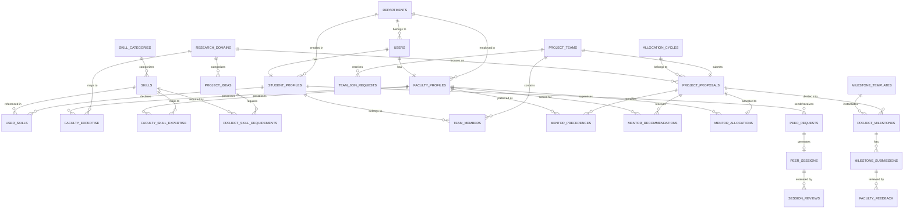

# LearnLink Complete Database Schema & Specifications

This document serves as the formal **Data Dictionary and Database Specification** for LearnLink. The database is designed strictly in **Third Normal Form (3NF)** and implemented on MySQL 8.0 (InnoDB).

---

## 1. Entity-Relationship Overview

---

## 2. Data Dictionary: Tables & Constraints

### 2.1 Identity & Academic Setup

#### 1. `departments`
Stores academic departments.
| Column | Type | Constraints | Description |
| :--- | :--- | :--- | :--- |
| `department_id` | INT AUTO_INCREMENT | PK | Unique department ID |
| `name` | VARCHAR(100) | NOT NULL, UNIQUE | Full department name |
| `code` | VARCHAR(10) | NOT NULL, UNIQUE | Short code (e.g., 'CSE', 'ECE') |
| `created_at` | TIMESTAMP | DEFAULT CURRENT_TIMESTAMP | Record creation time |

#### 2. `users`
Central authentication and identity master table.
| Column | Type | Constraints | Description |
| :--- | :--- | :--- | :--- |
| `user_id` | INT AUTO_INCREMENT | PK | Unique user identifier |
| `email` | VARCHAR(120) | NOT NULL, UNIQUE | University email address |
| `password_hash` | VARCHAR(255) | NOT NULL | Salted bcrypt password hash |
| `role` | ENUM('STUDENT', 'FACULTY', 'ADMIN') | NOT NULL | System role |
| `is_active` | BOOLEAN | DEFAULT TRUE | Account active flag |
| `created_at` | TIMESTAMP | DEFAULT CURRENT_TIMESTAMP | Account registration date |
| `updated_at` | TIMESTAMP | DEFAULT CURRENT_TIMESTAMP ON UPDATE CURRENT_TIMESTAMP | Last update |

#### 3. `student_profiles`
Student demographic and academic profile.
| Column | Type | Constraints | Description |
| :--- | :--- | :--- | :--- |
| `student_id` | INT AUTO_INCREMENT | PK | Student profile ID |
| `user_id` | INT | NOT NULL, UNIQUE, FK -> `users(user_id)` ON DELETE CASCADE | Linked user account |
| `roll_no` | VARCHAR(20) | NOT NULL, UNIQUE | University roll number |
| `department_id` | INT | NOT NULL, FK -> `departments(department_id)` | Enrolled department |
| `full_name` | VARCHAR(100) | NOT NULL | Student full name |
| `semester` | INT | NOT NULL, CHECK(`semester` BETWEEN 1 AND 12) | Current semester |
| `cgpa` | DECIMAL(3,2) | CHECK(`cgpa` BETWEEN 0.00 AND 10.00) | Current academic CGPA |
| `bio` | TEXT | NULL | Brief background & interests |
| `avg_peer_rating` | DECIMAL(3,2) | DEFAULT 0.00 | Cached rating from peer sessions |

#### 4. `faculty_profiles`
Faculty details, designations, and mentoring capacity limits.
| Column | Type | Constraints | Description |
| :--- | :--- | :--- | :--- |
| `faculty_id` | INT AUTO_INCREMENT | PK | Faculty profile ID |
| `user_id` | INT | NOT NULL, UNIQUE, FK -> `users(user_id)` ON DELETE CASCADE | Linked user account |
| `employee_code` | VARCHAR(20) | NOT NULL, UNIQUE | University employee ID |
| `department_id` | INT | NOT NULL, FK -> `departments(department_id)` | Department |
| `full_name` | VARCHAR(100) | NOT NULL | Faculty full name |
| `designation` | VARCHAR(50) | NOT NULL | E.g., 'Assistant Professor', 'HOD' |
| `max_project_capacity` | INT | NOT NULL, DEFAULT 3, CHECK(`max_project_capacity` >= 1) | Max concurrent project teams |

#### 5. `research_domains`
Academic disciplines and project domains.
| Column | Type | Constraints | Description |
| :--- | :--- | :--- | :--- |
| `domain_id` | INT AUTO_INCREMENT | PK | Research domain ID |
| `name` | VARCHAR(100) | NOT NULL, UNIQUE | E.g., 'Artificial Intelligence', 'Cybersecurity' |
| `description` | TEXT | NULL | Domain scope details |

---

### 2.2 Skills & Peer Exchange

#### 6. `skill_categories`
Master categories for skills.
| Column | Type | Constraints | Description |
| :--- | :--- | :--- | :--- |
| `category_id` | INT AUTO_INCREMENT | PK | Category ID |
| `name` | VARCHAR(50) | NOT NULL, UNIQUE | E.g., 'Programming', 'Cloud', 'Data Science' |

#### 7. `skills`
Master skill catalog.
| Column | Type | Constraints | Description |
| :--- | :--- | :--- | :--- |
| `skill_id` | INT AUTO_INCREMENT | PK | Skill ID |
| `category_id` | INT | NOT NULL, FK -> `skill_categories(category_id)` | Category |
| `name` | VARCHAR(100) | NOT NULL, UNIQUE | E.g., 'Python', 'React', 'Docker' |
| `description` | TEXT | NULL | Skill details |

#### 8. `user_skills`
Skills offered or desired by students.
| Column | Type | Constraints | Description |
| :--- | :--- | :--- | :--- |
| `user_skill_id` | INT AUTO_INCREMENT | PK | User skill record ID |
| `student_id` | INT | NOT NULL, FK -> `student_profiles(student_id)` ON DELETE CASCADE | Student |
| `skill_id` | INT | NOT NULL, FK -> `skills(skill_id)` ON DELETE CASCADE | Skill |
| `skill_type` | ENUM('OFFERED', 'WANTED') | NOT NULL | Can teach vs wants to learn |
| `proficiency_level` | INT | NOT NULL, CHECK(`proficiency_level` BETWEEN 1 AND 5) | Self-assessed proficiency |
| **Constraint** | UNIQUE(`student_id`, `skill_id`, `skill_type`) | Prevents duplicate declarations |

#### 9. `availability_slots`
Weekly availability time slots for peer sessions and consultations.
| Column | Type | Constraints | Description |
| :--- | :--- | :--- | :--- |
| `slot_id` | INT AUTO_INCREMENT | PK | Slot ID |
| `user_id` | INT | NOT NULL, FK -> `users(user_id)` ON DELETE CASCADE | Student or faculty |
| `day_of_week` | INT | NOT NULL, CHECK(`day_of_week` BETWEEN 1 AND 7) | 1=Monday ... 7=Sunday |
| `start_time` | TIME | NOT NULL | Slot start |
| `end_time` | TIME | NOT NULL | Slot end |
| **Constraint** | CHECK(`end_time` > `start_time`) | Start must precede end |

#### 10. `peer_requests`
Requests for peer mentorship.
| Column | Type | Constraints | Description |
| :--- | :--- | :--- | :--- |
| `request_id` | INT AUTO_INCREMENT | PK | Request ID |
| `requester_id` | INT | NOT NULL, FK -> `student_profiles(student_id)` | Learner |
| `peer_mentor_id` | INT | NOT NULL, FK -> `student_profiles(student_id)` | Peer offering guidance |
| `skill_id` | INT | NOT NULL, FK -> `skills(skill_id)` | Target skill |
| `message` | TEXT | NOT NULL | Request description |
| `status` | ENUM('PENDING', 'ACCEPTED', 'DECLINED', 'CANCELLED') | DEFAULT 'PENDING' | Status |
| `created_at` | TIMESTAMP | DEFAULT CURRENT_TIMESTAMP | Submission timestamp |
| **Constraint** | CHECK(`requester_id` != `peer_mentor_id`) | Cannot mentor oneself |

#### 11. `peer_sessions`
Scheduled peer learning sessions.
| Column | Type | Constraints | Description |
| :--- | :--- | :--- | :--- |
| `session_id` | INT AUTO_INCREMENT | PK | Session ID |
| `request_id` | INT | NOT NULL, UNIQUE, FK -> `peer_requests(request_id)` | Derived from accepted request |
| `scheduled_start` | DATETIME | NOT NULL | Start time |
| `scheduled_end` | DATETIME | NOT NULL | End time |
| `venue_or_link` | VARCHAR(255) | NOT NULL | Room # or meeting URL |
| `status` | ENUM('SCHEDULED', 'COMPLETED', 'CANCELLED') | DEFAULT 'SCHEDULED' | Lifecycle status |

#### 12. `session_reviews`
Post-session feedback and ratings.
| Column | Type | Constraints | Description |
| :--- | :--- | :--- | :--- |
| `review_id` | INT AUTO_INCREMENT | PK | Review ID |
| `session_id` | INT | NOT NULL, FK -> `peer_sessions(session_id)` | Session |
| `reviewer_id` | INT | NOT NULL, FK -> `student_profiles(student_id)` | Reviewer |
| `rating` | INT | NOT NULL, CHECK(`rating` BETWEEN 1 AND 5) | Score 1 to 5 |
| `feedback_text` | TEXT | NULL | Qualitative comments |
| `created_at` | TIMESTAMP | DEFAULT CURRENT_TIMESTAMP | Submission timestamp |
| **Constraint** | UNIQUE(`session_id`, `reviewer_id`) | Only one review per participant |

---

### 2.3 Research Projects & Teams

#### 13. `project_ideas`
Student or faculty proposed project concepts.
| Column | Type | Constraints | Description |
| :--- | :--- | :--- | :--- |
| `idea_id` | INT AUTO_INCREMENT | PK | Idea ID |
| `created_by` | INT | NOT NULL, FK -> `users(user_id)` | Proposer |
| `domain_id` | INT | NOT NULL, FK -> `research_domains(domain_id)` | Research field |
| `title` | VARCHAR(200) | NOT NULL | Project title |
| `abstract` | TEXT | NOT NULL | Problem statement & goals |
| `difficulty_level`| ENUM('BEGINNER', 'INTERMEDIATE', 'ADVANCED') | DEFAULT 'INTERMEDIATE' | Difficulty |
| `status` | ENUM('DRAFT', 'OPEN_FOR_MEMBERS', 'TEAM_FORMED', 'ARCHIVED') | DEFAULT 'OPEN_FOR_MEMBERS' | State |

#### 14. `project_skill_requirements`
Technical skills required for a project idea.
| Column | Type | Constraints | Description |
| :--- | :--- | :--- | :--- |
| `requirement_id` | INT AUTO_INCREMENT | PK | Requirement ID |
| `idea_id` | INT | NOT NULL, FK -> `project_ideas(idea_id)` ON DELETE CASCADE | Associated idea |
| `skill_id` | INT | NOT NULL, FK -> `skills(skill_id)` | Required skill |
| `importance_level`| ENUM('REQUIRED', 'NICE_TO_HAVE') | DEFAULT 'REQUIRED' | Priority |
| **Constraint** | UNIQUE(`idea_id`, `skill_id`) | No duplicate skill entries |

#### 15. `project_teams`
Student collaborative project groups.
| Column | Type | Constraints | Description |
| :--- | :--- | :--- | :--- |
| `team_id` | INT AUTO_INCREMENT | PK | Team ID |
| `idea_id` | INT | NULL, FK -> `project_ideas(idea_id)` | Selected idea |
| `team_name` | VARCHAR(100) | NOT NULL, UNIQUE | Unique team moniker |
| `leader_id` | INT | NOT NULL, FK -> `student_profiles(student_id)` | Team leader |
| `max_members` | INT | NOT NULL, DEFAULT 4, CHECK(`max_members` BETWEEN 1 AND 6) | Member limit |
| `status` | ENUM('FORMING', 'READY', 'ALLOCATED', 'COMPLETED') | DEFAULT 'FORMING' | Team lifecycle |

#### 16. `team_members`
Many-to-many relationship mapping students to teams.
| Column | Type | Constraints | Description |
| :--- | :--- | :--- | :--- |
| `membership_id` | INT AUTO_INCREMENT | PK | Record ID |
| `team_id` | INT | NOT NULL, FK -> `project_teams(team_id)` ON DELETE CASCADE | Team |
| `student_id` | INT | NOT NULL, FK -> `student_profiles(student_id)` | Member |
| `member_role` | ENUM('LEADER', 'MEMBER') | NOT NULL DEFAULT 'MEMBER' | Role within group |
| `joined_at` | TIMESTAMP | DEFAULT CURRENT_TIMESTAMP | Join date |
| `status` | ENUM('ACTIVE', 'LEFT') | DEFAULT 'ACTIVE' | Status |
| **Constraint** | UNIQUE(`team_id`, `student_id`) | Student cannot join same team twice |

#### 17. `team_join_requests`
Join requests from students wanting to join a forming team.
| Column | Type | Constraints | Description |
| :--- | :--- | :--- | :--- |
| `join_request_id` | INT AUTO_INCREMENT | PK | Join request ID |
| `team_id` | INT | NOT NULL, FK -> `project_teams(team_id)` ON DELETE CASCADE | Team |
| `student_id` | INT | NOT NULL, FK -> `student_profiles(student_id)` | Applicant |
| `message` | TEXT | NULL | Brief note from applicant |
| `status` | ENUM('PENDING', 'ACCEPTED', 'REJECTED') | DEFAULT 'PENDING' | Status |
| `created_at` | TIMESTAMP | DEFAULT CURRENT_TIMESTAMP | Application time |

#### 18. `allocation_cycles`
Academic term cycles during which projects and supervisors are allocated.
| Column | Type | Constraints | Description |
| :--- | :--- | :--- | :--- |
| `cycle_id` | INT AUTO_INCREMENT | PK | Cycle ID |
| `name` | VARCHAR(100) | NOT NULL, UNIQUE | E.g., 'Fall 2026 Capstone Cycle' |
| `semester` | INT | NOT NULL, CHECK(`semester` BETWEEN 1 AND 12) | Target semester |
| `academic_year`| VARCHAR(20) | NOT NULL | E.g., '2026-2027' |
| `start_date` | DATE | NOT NULL | Cycle starts |
| `end_date` | DATE | NOT NULL | Cycle ends |
| `status` | ENUM('UPCOMING', 'OPEN', 'ALLOCATION_IN_PROGRESS', 'CLOSED') | DEFAULT 'UPCOMING' | Cycle status |
| **Constraint** | CHECK(`end_date` > `start_date`) | Valid date range |

#### 19. `project_proposals`
Formal academic proposals submitted by teams for mentor allocation.
| Column | Type | Constraints | Description |
| :--- | :--- | :--- | :--- |
| `proposal_id` | INT AUTO_INCREMENT | PK | Proposal ID |
| `team_id` | INT | NOT NULL, UNIQUE, FK -> `project_teams(team_id)` | One proposal per team |
| `cycle_id` | INT | NOT NULL, FK -> `allocation_cycles(cycle_id)` | Academic cycle |
| `domain_id` | INT | NOT NULL, FK -> `research_domains(domain_id)` | Research domain |
| `title` | VARCHAR(200) | NOT NULL | Formal proposal title |
| `problem_statement` | TEXT | NOT NULL | Detailed problem description |
| `objectives` | TEXT | NOT NULL | Measurable goals |
| `status` | ENUM('SUBMITTED', 'UNDER_REVIEW', 'APPROVED', 'ALLOCATED', 'REJECTED') | DEFAULT 'SUBMITTED' | State |
| `submitted_at` | TIMESTAMP | DEFAULT CURRENT_TIMESTAMP | Submission timestamp |

---

### 2.4 Faculty Mentor Allocation & Recommendations

#### 20. `faculty_expertise`
Faculty domain expertise mapping.
| Column | Type | Constraints | Description |
| :--- | :--- | :--- | :--- |
| `expertise_id` | INT AUTO_INCREMENT | PK | ID |
| `faculty_id` | INT | NOT NULL, FK -> `faculty_profiles(faculty_id)` ON DELETE CASCADE | Faculty |
| `domain_id` | INT | NOT NULL, FK -> `research_domains(domain_id)` | Research domain |
| `expertise_level`| INT | NOT NULL, CHECK(`expertise_level` BETWEEN 1 AND 5) | Rating 1 to 5 |
| **Constraint** | UNIQUE(`faculty_id`, `domain_id`) | One rating per domain |

#### 21. `faculty_skill_expertise`
Granular skill competencies of faculty mentors.
| Column | Type | Constraints | Description |
| :--- | :--- | :--- | :--- |
| `fse_id` | INT AUTO_INCREMENT | PK | ID |
| `faculty_id` | INT | NOT NULL, FK -> `faculty_profiles(faculty_id)` ON DELETE CASCADE | Faculty |
| `skill_id` | INT | NOT NULL, FK -> `skills(skill_id)` | Technical skill |
| `proficiency_level`| INT | NOT NULL, CHECK(`proficiency_level` BETWEEN 1 AND 5) | Rating 1 to 5 |
| **Constraint** | UNIQUE(`faculty_id`, `skill_id`) | One rating per skill |

#### 22. `mentor_preferences`
Team ranked preferences for desired faculty supervisors.
| Column | Type | Constraints | Description |
| :--- | :--- | :--- | :--- |
| `preference_id` | INT AUTO_INCREMENT | PK | ID |
| `proposal_id` | INT | NOT NULL, FK -> `project_proposals(proposal_id)` ON DELETE CASCADE | Proposal |
| `faculty_id` | INT | NOT NULL, FK -> `faculty_profiles(faculty_id)` | Preferred mentor |
| `preference_rank`| INT | NOT NULL, CHECK(`preference_rank` BETWEEN 1 AND 5) | 1st choice, 2nd, etc. |
| **Constraint** | UNIQUE(`proposal_id`, `preference_rank`) | No duplicate ranks |
| **Constraint** | UNIQUE(`proposal_id`, `faculty_id`) | Cannot select same faculty twice |

#### 23. `mentor_recommendations`
Explainable scores generated by the recommendation engine.
| Column | Type | Constraints | Description |
| :--- | :--- | :--- | :--- |
| `recommendation_id` | INT AUTO_INCREMENT | PK | ID |
| `proposal_id` | INT | NOT NULL, FK -> `project_proposals(proposal_id)` ON DELETE CASCADE | Proposal |
| `faculty_id` | INT | NOT NULL, FK -> `faculty_profiles(faculty_id)` | Evaluated mentor |
| `match_score` | DECIMAL(5,2) | NOT NULL, CHECK(`match_score` BETWEEN 0.00 AND 100.00) | Composite score |
| `rank_order` | INT | NOT NULL | Ranked order (1=best) |
| `score_breakdown` | JSON | NOT NULL | Detailed breakdown (domain, skill, pref, etc.) |
| `created_at` | TIMESTAMP | DEFAULT CURRENT_TIMESTAMP | Calculation timestamp |

#### 24. `mentor_allocations`
Final approved faculty supervisor assignment.
| Column | Type | Constraints | Description |
| :--- | :--- | :--- | :--- |
| `allocation_id` | INT AUTO_INCREMENT | PK | ID |
| `proposal_id` | INT | NOT NULL, UNIQUE, FK -> `project_proposals(proposal_id)` | One active allocation per project |
| `faculty_id` | INT | NOT NULL, FK -> `faculty_profiles(faculty_id)` | Assigned supervisor |
| `cycle_id` | INT | NOT NULL, FK -> `allocation_cycles(cycle_id)` | Academic cycle |
| `status` | ENUM('ACTIVE', 'COMPLETED', 'REVOKED') | DEFAULT 'ACTIVE' | Status |
| `allocated_at` | TIMESTAMP | DEFAULT CURRENT_TIMESTAMP | Allocation timestamp |
| `allocated_by` | INT | NOT NULL, FK -> `users(user_id)` | Admin responsible |

#### 25. `allocation_audit_logs`
Immutable audit log tracking every mentor allocation, override, and revocation.
| Column | Type | Constraints | Description |
| :--- | :--- | :--- | :--- |
| `log_id` | INT AUTO_INCREMENT | PK | Log entry ID |
| `allocation_id` | INT | NOT NULL, FK -> `mentor_allocations(allocation_id)` | Target allocation |
| `action` | ENUM('ASSIGNED', 'REASSIGNED', 'REVOKED') | NOT NULL | Action performed |
| `performed_by` | INT | NOT NULL, FK -> `users(user_id)` | Admin/system user |
| `reason` | TEXT | NULL | Justification for action |
| `created_at` | TIMESTAMP | DEFAULT CURRENT_TIMESTAMP | Timestamp |

---

### 2.5 Milestones, Reviews, and Consultations

#### 26. `milestone_templates`
Standard departmental milestone blueprint.
| Column | Type | Constraints | Description |
| :--- | :--- | :--- | :--- |
| `template_id` | INT AUTO_INCREMENT | PK | Template ID |
| `name` | VARCHAR(100) | NOT NULL, UNIQUE | E.g., 'Project Synopsis', 'Final Viva' |
| `sequence_no` | INT | NOT NULL, UNIQUE | Sequential order (1, 2, 3...) |
| `weightage_percent`| INT | NOT NULL, CHECK(`weightage_percent` BETWEEN 1 AND 100) | Evaluation percentage |
| `description` | TEXT | NULL | Deliverables expected |

#### 27. `project_milestones`
Instantiated milestones for an allocated project proposal.
| Column | Type | Constraints | Description |
| :--- | :--- | :--- | :--- |
| `milestone_id` | INT AUTO_INCREMENT | PK | Milestone ID |
| `proposal_id` | INT | NOT NULL, FK -> `project_proposals(proposal_id)` ON DELETE CASCADE | Associated project |
| `template_id` | INT | NOT NULL, FK -> `milestone_templates(template_id)` | Template reference |
| `due_date` | DATE | NOT NULL | Submission deadline |
| `status` | ENUM('PENDING', 'SUBMITTED', 'APPROVED', 'REVISIONS_REQUIRED', 'OVERDUE') | DEFAULT 'PENDING' | Status |

#### 28. `milestone_submissions`
Student artifact submissions for project milestones.
| Column | Type | Constraints | Description |
| :--- | :--- | :--- | :--- |
| `submission_id` | INT AUTO_INCREMENT | PK | Submission ID |
| `milestone_id` | INT | NOT NULL, FK -> `project_milestones(milestone_id)` ON DELETE CASCADE | Target milestone |
| `version_no` | INT | NOT NULL DEFAULT 1 | Iteration number |
| `submitted_by` | INT | NOT NULL, FK -> `student_profiles(student_id)` | Student uploader |
| `file_url` | VARCHAR(255) | NOT NULL | Document URL or storage path |
| `notes` | TEXT | NULL | Submission remarks |
| `submitted_at` | TIMESTAMP | DEFAULT CURRENT_TIMESTAMP | Submission timestamp |

#### 29. `faculty_feedback`
Formal evaluations and grading by the supervising faculty.
| Column | Type | Constraints | Description |
| :--- | :--- | :--- | :--- |
| `feedback_id` | INT AUTO_INCREMENT | PK | Feedback ID |
| `submission_id` | INT | NOT NULL, FK -> `milestone_submissions(submission_id)` ON DELETE CASCADE | Reviewed submission |
| `faculty_id` | INT | NOT NULL, FK -> `faculty_profiles(faculty_id)` | Reviewer |
| `score` | INT | NOT NULL, CHECK(`score` BETWEEN 0 AND 100) | Grade awarded |
| `comments` | TEXT | NOT NULL | Constructive feedback |
| `decision` | ENUM('APPROVED', 'CHANGES_REQUESTED') | NOT NULL | Evaluation outcome |
| `reviewed_at` | TIMESTAMP | DEFAULT CURRENT_TIMESTAMP | Review timestamp |

#### 30. `consultation_meetings`
Scheduled consultation and progress meetings between mentor and team.
| Column | Type | Constraints | Description |
| :--- | :--- | :--- | :--- |
| `meeting_id` | INT AUTO_INCREMENT | PK | Meeting ID |
| `allocation_id` | INT | NOT NULL, FK -> `mentor_allocations(allocation_id)` ON DELETE CASCADE | Allocation |
| `scheduled_at` | DATETIME | NOT NULL | Date & time |
| `mode` | ENUM('OFFLINE', 'ONLINE') | DEFAULT 'OFFLINE' | Consultation mode |
| `status` | ENUM('SCHEDULED', 'COMPLETED', 'CANCELLED') | DEFAULT 'SCHEDULED' | Meeting status |
| `agenda` | TEXT | NOT NULL | Planned discussion |
| `minutes_of_meeting` | TEXT | NULL | Post-meeting notes |

#### 31. `notifications`
In-app alert records.
| Column | Type | Constraints | Description |
| :--- | :--- | :--- | :--- |
| `notification_id` | INT AUTO_INCREMENT | PK | Notification ID |
| `user_id` | INT | NOT NULL, FK -> `users(user_id)` ON DELETE CASCADE | Target recipient |
| `type` | VARCHAR(50) | NOT NULL | E.g., 'ALLOCATION', 'MILESTONE_DUE' |
| `title` | VARCHAR(150) | NOT NULL | Alert title |
| `message` | TEXT | NOT NULL | Alert body text |
| `is_read` | BOOLEAN | DEFAULT FALSE | Read indicator |
| `created_at` | TIMESTAMP | DEFAULT CURRENT_TIMESTAMP | Alert creation timestamp |

---

## 3. Database Views

1. **`vw_faculty_workload`**:
   Shows each faculty member, their department, maximum capacity, number of active allocated projects, and remaining open slots.
2. **`vw_team_skill_gaps`**:
   Cross-references each team's linked project idea requirements against all skills offered by its active members, listing missing skills and completion percentage.
3. **`vw_project_milestone_progress`**:
   Computes total milestones, completed milestones, average score, and overdue status for all active projects.
4. **`vw_peer_mentor_rankings`**:
   Lists student peer mentors ranked by average review score and number of completed peer sessions.
5. **`vw_department_analytics`**:
   High-level report on total proposals, approved count, mentor allocation rate, and pending submissions per department.

---

## 4. Stored Procedures & Functions

1. **`sp_allocate_mentor_transaction`**:
   Executes an atomic ACID transaction to:
   - Acquire an exclusive row-lock on the faculty profile (`SELECT ... FOR UPDATE`).
   - Verify remaining capacity and proposal eligibility.
   - Insert row into `mentor_allocations`.
   - Update `project_proposals.status` to `'ALLOCATED'`.
   - Instantiate records in `project_milestones` derived from `milestone_templates`.
   - Insert an entry into `allocation_audit_logs`.
   - Create notification records for the team leader and faculty.
2. **`sp_run_cycle_recommendations`**:
   Iterates through all unallocated proposals in an active cycle, calculates normalized match scores across all eligible department faculty, and persists ranked suggestions in `mentor_recommendations`.
3. **`fn_get_team_skill_gap_count`**:
   Scalar function returning the integer count of missing required skills for a given team.

---

## 5. Triggers

1. **`trg_enforce_faculty_capacity`** (`BEFORE INSERT ON mentor_allocations`):
   Fails insertion if current active allocations for the faculty reach `max_project_capacity`.
2. **`trg_prevent_multiple_active_allocations`** (`BEFORE INSERT ON mentor_allocations`):
   Fails insertion if the proposal already has an active supervisor.
3. **`trg_recalculate_peer_rating`** (`AFTER INSERT OR UPDATE ON session_reviews`):
   Recalculates and updates the `avg_peer_rating` column on `student_profiles`.
4. **`trg_log_allocation_audit`** (`AFTER UPDATE OR DELETE ON mentor_allocations`):
   Inserts historical record into `allocation_audit_logs` tracking state transitions.
